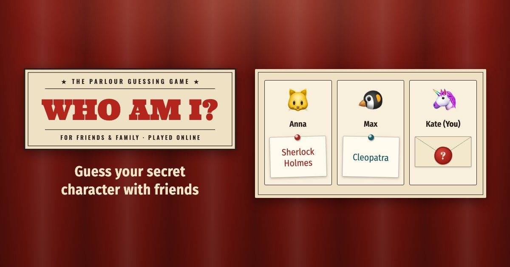
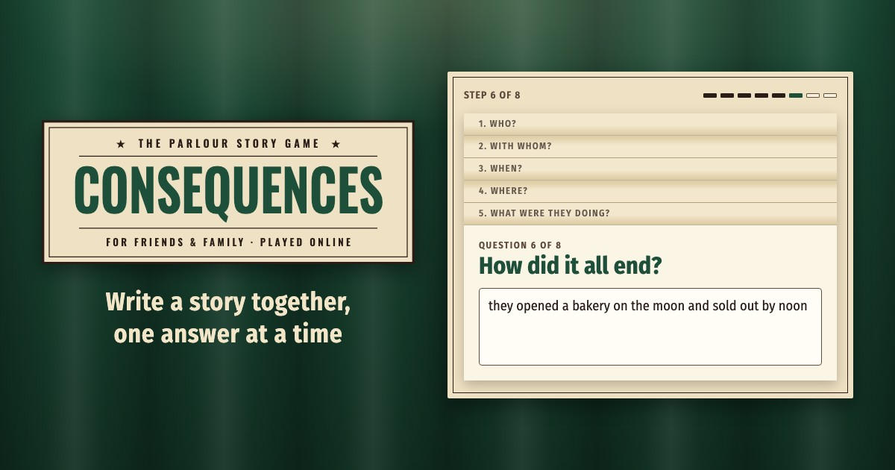

# Parlour Games

Parlour games to play remotely with friends and family. Create a room, send the link, play — no accounts, nothing to install.

## Games

### Who am I?



The classic guessing party game: every player gets a secret character chosen by the others and asks yes/no questions to find out who they are.

**Play:** https://whoami.escapist.club/ · **Code:** [`games/whoami/`](games/whoami/README.md)

### Consequences



The parlour story game: every player answers the same question on their sheet — who, with whom, when, where, what they were doing, how it ended, what people said, the moral — and passes the sheet on, nobody seeing the answers before; at the end everyone reads out the story that came to them.

**Play:** https://story.escapist.club/ · **Code:** [`games/consequences/`](games/consequences/README.md)

## How to Run

Every game is a web app on Cloudflare Workers, whole in its own folder under `games/`, with its own address. What the games share — the rooms' base, the page's socket, the player's identity, translations, security headers — is one package, [`packages/room-kit/`](packages/room-kit/README.md), that every game takes from. The tools are shared too: one `npm install` at the root, Node.js 22 or newer.

```bash
npm install
npm start -w games/whoami          # one game: http://localhost:8787 (games/consequences: 8788)
npx playwright install chromium    # once: the browser for the browser tests
npm test                           # every game's and the kit's checks: ESLint, Jest, then the games in a real browser (Playwright)
```

- `CLAUDE.md` — the repository's layout, commands, git flow and decisions; each game and the kit have their own for their architecture and rules
- `docs/release.md` — releasing a game, hotfixes and the check of production
- `openspec/` — the plans of changes, finished ones in `openspec/changes/archive/`

The documents in `docs/` and the plans in `openspec/` are written in Russian.

## Contributing

This is a personal project, open to read and to learn from. Bug reports and ideas are welcome as [issues](https://github.com/mikhail-e/parlour-games/issues); I don't plan to accept pull requests.

To report a security problem, see [SECURITY.md](SECURITY.md) — please don't open a public issue for it.

## License

The code is released under the [MIT License](LICENSE).

The license does not cover the games' brands. For "Who am I?": the "WHO AM I?" sign (`svg.brand-sign` in the pages), the wax-seal app icon (`games/whoami/public/icons/`, `games/whoami/public/favicon.ico`, `games/whoami/scripts/icon.html`) and the link preview picture (`games/whoami/public/img/og-image-2.jpg`, `games/whoami/scripts/og-image.html`). For Consequences: the "CONSEQUENCES" sign (`svg.brand-sign` in the pages), the folded-sheet app icon (`games/consequences/public/icons/`, `games/consequences/public/favicon.ico`, `games/consequences/scripts/icon.html`) and the link preview picture (`games/consequences/public/img/og-image.jpg`, `games/consequences/scripts/og-image.html`). All rights to them are reserved (except the emoji avatars in whoami's picture, drawn by the system's emoji font); a copy of a game must replace them with its own.

Third-party files keep their own licenses: the fonts in `packages/room-kit/public/kit/fonts/` (SIL Open Font License; Ultra — Apache License 2.0; the license files are next to the fonts) and Bootstrap in `packages/room-kit/public/kit/vendor/bootstrap/` (MIT). The cup in the Buy Me a Coffee button (`packages/room-kit/public/kit/img/bmc-cup.svg`) is Buy Me a Coffee's logo.

## Credits

Developed with [Claude Code](https://claude.ai/claude-code).
