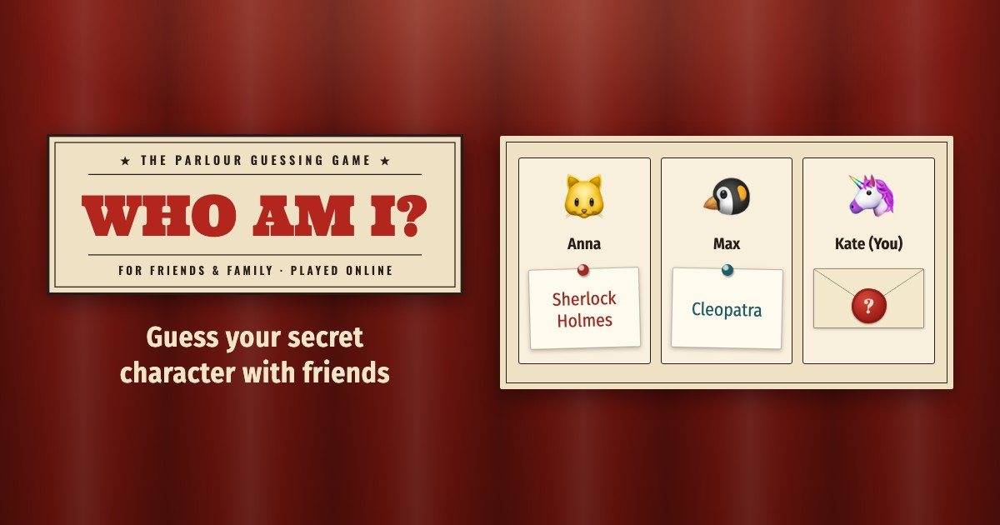

# Who am I?



The classic guessing party game, played remotely. Every player gets a secret character chosen by the others and asks yes/no questions to find out who they are. Create a room, send the link to friends and family, play — no accounts, nothing to install.

**Play:** https://whoami.escapist.club/

## Features

- Rooms with a 6-character code and a link to share (the Share button opens the phone's share sheet)
- Players assign characters to each other; your own stays hidden until you reveal it
- Emoji avatars or your own photo
- English and Russian
- Reconnects after a lost connection
- Installable as an app (PWA); needs an internet connection

## How to Run

The game is one of the [parlour-games](../../README.md) monorepo. Running it needs Node.js 22 or newer: `npm start` runs `wrangler dev`, the Cloudflare Workers runtime on your machine, with the game's rooms (Durable Objects) and files.

```bash
npm install                  # at the repository root
npm start -w games/whoami    # http://localhost:8787 (or npm start in this folder)
```

## Development

In this folder (from the repository root: `-w games/whoami` after the command):

```bash
npx playwright install chromium   # once: the browser for the browser tests
npm test           # all checks: ESLint, Jest, then the game in a real browser (Playwright)
npm run lint       # ESLint only
npm run test:e2e   # browser tests only: a phone and a desktop, several players per room
```

- [`CLAUDE.md`](CLAUDE.md) — architecture and rules (the repository's layout and git flow: the [root CLAUDE.md](../../CLAUDE.md))
- [`docs/testing.md`](docs/testing.md) — how the tests are organized and written
- [`docs/release.md`](../../docs/release.md) (the repository's) — releases, hotfixes and the check of production
- [`docs/publishing.md`](docs/publishing.md) — link previews, robots, where the site's address is written

The documents in `docs/` are written in Russian.

## Technologies

- Server: Cloudflare Workers and Durable Objects (one per room), WebSocket
- Browser: plain JavaScript and Bootstrap 5 — no framework, no build step
- Checks: ESLint, Jest, Playwright and axe-core
- Hosting: Cloudflare (Workers Builds deploys every push to master that changes the game)

## Contributing

This is a personal project, open to read and to learn from. Bug reports and ideas are welcome as [issues](https://github.com/mikhail-e/parlour-games/issues); I don't plan to accept pull requests.

To report a security problem, see [SECURITY.md](../../SECURITY.md) — please don't open a public issue for it.

## License

The code is released under the [MIT License](../../LICENSE). The license does not cover the game's brand — the sign, the wax-seal app icon and the link preview picture — and third-party files keep their own licenses: see [License](../../README.md#license) in the repository's README.

## Credits

Developed with [Claude Code](https://claude.ai/claude-code).
